<picture>
  <source media="(prefers-color-scheme: dark)" srcset="assets/hero-dark.svg">
  <source media="(prefers-color-scheme: light)" srcset="assets/hero-light.svg">
  
</picture>

## ✦ Projects

<table>
  <tr>
    <td width="50%" valign="top">
      <a href="https://github.com/muyuzhong/boardcast"><b>boardcast</b></a> TypeScript 
      Talk, and the whiteboard draws itself. 本地优先的实时会议图表，支持 Linux / Windows ARM / macOS。
    </td>
    <td width="50%" valign="top">
      <a href="https://github.com/muyuzhong/rea"><b>rea</b></a> TypeScript 
      Reverse engineer anything with agents, from app behavior down to native binaries.
    </td>
  </tr>
  <tr>
    <td width="50%" valign="top">
      <a href="https://github.com/muyuzhong/Featherlog"><b>Featherlog</b></a> TypeScript · ★ 4 
      <!-- TODO: 一句话介绍 -->
    </td>
    <td width="50%" valign="top">
      <a href="https://github.com/muyuzhong/LowTemp"><b>LowTemp</b></a> TypeScript · ★ 4 
      <!-- TODO: 一句话介绍 -->
    </td>
  </tr>
</table>

## ✦ Activity

<picture>
  <source media="(prefers-color-scheme: dark)" srcset="assets/stats-dark.svg">
  <source media="(prefers-color-scheme: light)" srcset="assets/stats-light.svg">
  
</picture>

  图表由 <a href="scripts/generate.py"><code>scripts/generate.py</code></a> 根据真实提交记录生成，GitHub Actions 每 6 小时自动更新。

